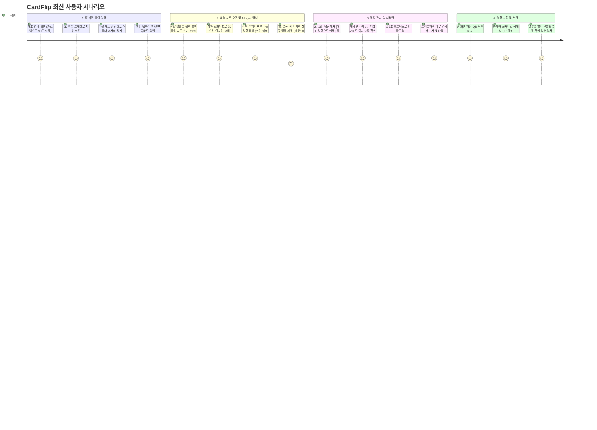

# [PRD] 제품 요구사항 정의서 (Product Requirements Document)
## 프로젝트명: CardFlip (차세대 인터랙티브 3D 디지털 명함 앱)

> **문서 버전**: v2.0 (최신 구현 반영본)  
> **최종 갱신일**: 2026-11-17  

---

## 1. 개요 (Overview)

### 1.1 프로젝트 정의
**CardFlip**은 사용자가 자신의 다양한 페르소나를 3차원 디지털 명함으로 제작·커스텀하고, 모바일 세로 뷰포트에 최적화된 3D 뷰어와 2-Layer 바텀 시트 인터페이스를 통해 직관적으로 탐색·교환하며, 수집된 명함을 스마트하게 관리할 수 있는 **인터랙티브 웹-Processing 4 하이브리드 디지털 명함 애플리케이션**입니다.

### 1.2 핵심 개발 목표
- **Processing 4 완전 호환**: Processing 4 IDE에서 재생(▶) 버튼 클릭 1회만으로 로컬 실행.
- **물리 인터랙션 완성도**: 3D 명함 관성 회전(Inertia), 원터치 똑바로 정렬, 2-Layer 투명 명함 스킨 투영, 1:1 실시간 손가락 트래킹 및 50% 임계값 스냅.
- **스마트폰 현장 시연 최적화**: Wi-Fi 로컬 네트워크 접속(`http://192.168.0.31:5173`) 및 카메라 QR 스캔 지원.

---

## 2. 사용자 시나리오 (User Scenarios)

---

## 3. 기능적 요구사항 (Functional Requirements)

### FR-01: 홈 화면 및 3D 대표 명함
- **FR-01-1 [대표 명함 단독 고정]**: 홈 화면에서는 사용자가 대표로 설정한 명함 단 1장만 표시되며, 좌우 스와이프로 다른 명함으로 변경되지 않는다.
- **FR-01-2 [90° 시계방향 회전]**: 세로 폰 화면 안에서 명함이 가장 크고 시원하게 보이도록 가로 명함 텍스트를 시계방향 90도 회전하여 렌더링한다.
- **FR-01-3 [물리 관성 회전]**: 드래그 속도를 실시간 추적하여 손을 떼도 잔여 속도로 회전하다가 감속 계수(`0.94`)에 따라 서서히 정지한다. 멈춘 각도 그대로 유지된다.
- **FR-01-4 [단일 탭 수직 똑바로 정렬]**: 명함이 어느 각도로 기울어져 있든 가볍게 한 번 터치하면 X축 틸트가 0으로 초기화되고, 앞면(0°) 또는 뒷면(180°)으로 똑바로 정렬된다.
- **FR-01-5 [정면 최적화 조명]**: 전방향 환경광(`0.95`)과 듀얼 정면 키라이트(`0.95`)를 배치하여 정면에서 어두운 음영이나 눈부신 글레어 없이 환하고 또렷하게 표시된다.
- **FR-01-6 [하단 컨트롤러]**: 화면 하단 정중앙에 QR 버튼, 최하단에 바텀 시트 인출 핸들을 배치한다.

### FR-02: 바텀 시트 화면 및 2-Layer 물리 메커니즘
- **FR-02-1 [프레임 및 안내 문구 배제]**: 테두리 박스와 모든 가이드 텍스트(`상하 스와이프`, `좌우 스와이프`), 메타 아이콘을 완전 삭제하고 순수 미니멀리즘으로 플롯한다.
- **FR-02-2 [2D 정면 투명 명함]**: 틸트/회전 없는 2D 앞면 뷰 고정. 텍스트와 테두리 외 100% 투명 처리하여 배후 스킨이 그대로 비친다.
- **FR-02-3 [2-Layer 스킨 투영 & 지속성]**: 
  - 중앙 도크에 고정된 2D 순수 컬러 스킨 플레이트(뒷단)와 수평 명함 트랙(앞단)으로 구성된다.
  - 상하 스와이프로 스킨을 교체하며, 좌우로 명함을 넘겨도 현재 상하 스와이프된 스킨이 중앙 도크에 유지되어 새로 들어온 명함에 연속 투영된다.
- **FR-02-4 [명함 순서 체계 및 피크]**: 
  - 시퀀스: `0 (새 명함 제작)` — `1 (대표 명함)` — `2 (명함 2)` — `3 (명함 3) ...`
  - 명함 목록은 우측으로만 선형 스택되며, 우측 다음 명함의 일부(~40px)가 살짝 노출(Peek-in)된다.
  - 대표 명함(1번)에서 좌측으로 넘기면 `0번 [+ 새 명함 제작]` 슬롯이 나타난다.
- **FR-02-5 [[+ 새 명함 제작] 슬롯]**: 340×200 규격 투명 카드 중앙에 흰색 테두리 + 녹색 플러스(`+`) 아이콘 단독 배치. 터치 시 제작 모달 오픈, 새로 만든 카드는 목록 맨 끝(Tail)으로 추가된다.
- **FR-02-6 [하단 2단 버튼 구성]**:
  - 상단: `[★ 대표 명함으로 설정]` (탭 시 해당 명함을 1번 자리로 승격, 기존 대표는 우측으로 한 칸 이동) / `[★ 현재 대표 명함]` (1번 슬롯 시 활성 상태)
  - 하단: `[명함첩]` (상단과 완전히 동일한 크기 및 둥근 모서리 규격)
  - 바텀 시트 내 QR 버튼은 완전 삭제된다.
- **FR-02-7 [1.5초 롱프레스 제스처]**:
  - 중앙 명함을 1.5초간 누르고 있으면 카드가 살짝 플로팅(`scale-105`, 엘리베이션 그림자)한다.
  - 유지한 채 좌우 드래그 시 이웃 명함과 순서 맞바꿈(Swap), 손을 떼면 명함 정보 수정 모달이 실행된다.

### FR-03: 물리 제스처 및 50% 임계값 스냅
- **FR-03-1 [1:1 실시간 트래킹]**: 명함 수평 이동, 스킨 수직 이동, 시트 열기/닫기, 명함첩 서랍 닫기 등 모든 스와이프 동작 시 손가락 움직임을 지연 없이 1:1로 실시간 추적한다.
- **FR-03-2 [50% 임계값 스냅 판정]**:
  - 명함 수평 스와이프: 카드 폭 50% (`158px`) 기준 스냅 이동 / 스냅 백.
  - 스킨 수직 스와이프: 스킨 높이 50% (`50px`) 기준 스냅 장착 / 스냅 백.
  - 바텀 시트 열기: 인출 거리 50% (`120px`) 기준 스냅 오픈 / 스냅 백.
  - 바텀 시트 닫기: 시트 하강 50% (`120px`) 기준 스냅 닫기 / 스냅 백.
  - 명함첩 서랍 닫기: 서랍 폭 50% (`140px`) 기준 스냅 닫기 / 스냅 백.
