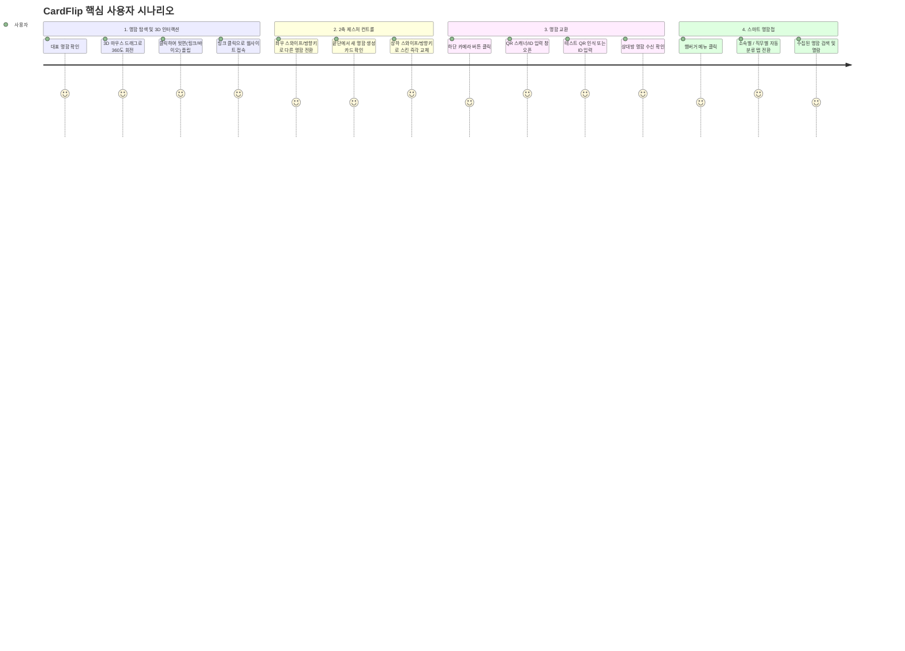

# [PRD] 제품 요구사항 정의서 (Product Requirements Document)
## 프로젝트명: CardFlip (차세대 인터랙티브 3D 디지털 명함 앱)

---

## 1. 개요 (Overview)

### 1.1 프로젝트 정의
**CardFlip**은 사용자가 자신의 다양한 페르소나(본업, 부업, 포트폴리오, 소셜 등)를 3차원 디지털 명함으로 제작·커스텀하고, QR 코드와 고유 ID를 통해 간편하게 교환하며, 수집된 명함을 소속 및 직무별로 스마트하게 분류·관리할 수 있는 **인터랙티브 웹-Processing 4 하이브리드 디지털 명함 애플리케이션**입니다.

### 1.2 프로젝트 성격 및 목표
- **과제 성격**: 대학 인터랙티브 프로그래밍 / 뉴미디어 기말 과제 제출용 프로토타입
- **실행 제약**: 외부 종속성 없이 **Processing 4 IDE에서 재생(▶) 버튼 클릭 1회만으로 즉시 실행**
- **시연 목표**: 로그인이나 상용 클라우드 배포 없이도, 로컬 환경에서 감각적인 3D 카드 틸팅/플립, 2축 제스처 조작, 실시간 스킨 교체, QR 스캔 및 스마트 명함첩의 모든 인터랙션을 매끄럽게 시연

---

## 2. 타깃 사용자 및 페르소나 (Target Personas)

| 페르소나 | 주요 특징 | 앱 내 활용 시나리오 |
| :--- | :--- | :--- |
| **대학생 / 취준생 (김민수, 24세)** | 학업, 동아리, 포트폴리오 링크를 깔끔하게 전달하고 싶음 | 앞면에는 소속 학과와 연락처, 뒷면에는 GitHub 및 Notion 포트폴리오 링크를 담아 네트워킹 행사에서 교환 |
| **프리랜서 / N잡러 (이서연, 27세)** | 디자이너 본업과 영상 크리에이터 부업 등 복수 명함 필요 | 좌우 스와이프로 '디자이너 명함'과 '크리에이터 명함'을 즉시 전환하고, 상하 스와이프로 감각적인 홀로그램 스킨 적용 |
| **심사자 / 교수님 (평가 페르소나)** | 별도 설정이나 로그인 없이 3~5분 내에 핵심 기능을 검증하고자 함 | Processing 4에서 Run 버튼을 눌러 브라우저 자동 실행 후, 사전 탑재된 샘플 데이터를 통해 명함 3D 회전, 스킨 변경, QR 스캔, 자동 분류를 한눈에 확인 |

---

## 3. 핵심 사용자 시나리오 (User Scenarios)

---

## 4. 기능적 요구사항 (Functional Requirements)

### FR-01: 멀티 명함 관리 (Multi-Card Management)
- **FR-01-1**: 사용자는 최소 1개 이상의 개인 디지털 명함을 생성하고 관리할 수 있어야 한다.
- **FR-01-2**: 각 명함은 [대표 명함]으로 지정할 수 있으며, 앱 실행 시 대표 명함이 메인 스테이지에 표시된다.
- **FR-01-3**: 홈 화면에서 좌우 스와이프(또는 좌우 방향키/버튼)를 통해 보유 명함을 캐러셀 형태로 순차 전환할 수 있어야 한다.
- **FR-01-4**: 명함 목록의 마지막 슬라이드에는 `[+ 새 명함 만들기]` 카드가 배치되어 새 프로필 작성이 가능해야 한다.

### FR-02: 3D 자유 회전 및 양면 정보 기록 (3D Card Interaction)
- **FR-02-1**: 3D 공간 상에서 마우스 드래그(또는 터치 드래그) 시 카드가 상하좌우 360° 자유롭게 회전해야 한다.
- **FR-02-2**: 마우스 릴리즈 시 부드러운 감쇠(Damping)를 적용하며 기본 각도로 복귀해야 한다.
- **FR-02-3**: 더블 클릭 또는 플립 토글 버튼 클릭 시 카드가 180° 반전되어 앞면과 뒷면이 전환되어야 한다.
- **FR-02-4**:
  - **앞면 (Front)**: 이름, 소속(회사/학교), 직업/직무, 이메일, 전화번호, 프로필 사진
  - **뒷면 (Back)**: 한 줄 소개/비전 문구, 하이퍼링크 칩 목록, 고유 명함 ID 및 QR 코드

### FR-03: 5종 시그니처 3D 스킨 시스템 (Skin Customization)
- **FR-03-1**: 현재 활성화된 명함에 대해 상하 스와이프(또는 상하 방향키/버튼)를 통해 보유 스킨을 실시간으로 롤링 적용할 수 있어야 한다.
- **FR-03-2**: 지원하는 기본 5종 스킨:
  1. `Holographic Prism`: 빛 각도에 따라 무지개색 스펙트럼이 반사되는 프리즘 셰이더
  2. `Matte Dark Obsidian`: 세련된 무광 흑요석 질감에 미세한 림 라이트
  3. `Glassmorphism Frost`: 반투명 블러 굴절 아크릴 스타일
  4. `Cyberpunk Neon`: 어두운 배경에 발광 네온 그리드 라인
  5. `Minimal Champagne Gold`: 은은한 브러시드 골드 메탈릭 텍스처
- **FR-03-3**: 스킨 변경 시 시각적 광택 애니메이션 및 즉각적인 머티리얼 반응이 제공되어야 한다.

### FR-04: 스마트 하이퍼링크 (Interactive URL Links)
- **FR-04-1**: 명함 뒷면(또는 앞면 하단)에 등록된 URL 칩(`GitHub`, `Notion`, `Portfolio`, `LinkedIn`, `Instagram` 등)을 배치한다.
- **FR-04-2**: URL 칩 클릭 시 해당 웹 주소가 새 탭(Window/Tab)으로 즉시 열려야 한다.

### FR-05: QR 코드 & 고유 ID 교환 모달 (Exchange System)
- **FR-05-1**: 홈 화면 하단에 플로팅 카메라/QR 버튼이 상시 노출되어야 한다.
- **FR-05-2**: 버튼 클릭 시 바텀 시트 형태의 교환 모달이 부드럽게 슬라이드업되어야 한다.
- **FR-05-3**: 교환 모달은 다음 3가지 영역으로 구성된다:
  - **상단**: 웹캠 기반 실시간 QR 스캐너 뷰파인더
  - **중단**: 고유 ID(예: `@minsu_ui`)를 수동 입력하여 교환하는 입력 필드 및 [교환] 버튼
  - **하단**: 평가/시연 환경을 위한 **[1초 테스트 QR 스캔 시뮬레이션 버튼]** 및 **[내 명함 QR 보기]** 토글
- **FR-05-4**: 교환 성공 시 알림 토스트와 함께 상대방 명함이 즉시 명함첩에 저장되어야 한다.

### FR-06: 소속/직무 기반 지능형 명함첩 (Smart Wallet)
- **FR-06-1**: 홈 화면 좌측 상단 햄버거 메뉴(☰) 클릭 시 좌측 드로어로 명함첩이 오픈되어야 한다.
- **FR-06-2**: 교환된 명함 목록은 상단 탭 필터를 통해 분류 방식을 즉시 전환할 수 있어야 한다:
  - `전체 보기 (All)`
  - `소속별 보기 (By Affiliation)`: 회사, 대학교 등 소속별 아코디언 폴더 그룹화
  - `직업별 보기 (By Occupation)`: 디자이너, 개발자, 기획자 등 직무별 태그 그룹화
  - `즐겨찾기 (Starred)`
- **FR-06-3**: 명함첩 내 카드를 클릭하면 해당 명함의 3D 뷰어 모달이 열려 앞/뒷면 확인 및 등록된 링크로 접속할 수 있어야 한다.

### FR-07: 로컬 데이터 지속성 & 데모 시드 데이터 (Data Persistence)
- **FR-07-1**: 브라우저의 `localStorage`를 활용하여 생성한 명함, 선택한 스킨, 교환된 명함 목록이 새로고침 후에도 유지되어야 한다.
- **FR-07-2**: 첫 실행 시 시연을 위한 **풍성한 샘플 데이터(기본 명함 3장, 교환 명함 8장)**가 기본 적재되어 있어야 한다.
- **FR-07-3**: 설정 메뉴에 **[시연 데이터 초기화]** 버튼을 두어 언제든 초기 데모 상태로 원복할 수 있어야 한다.

### FR-08: 모바일 기기 실물 시연 지원 (Mobile & Gyroscope Support)
- **FR-08-1**: Processing 4 실행 창에 컴퓨터의 로컬 네트워크 IP(예: `http://192.168.x.x:8080/`)와 함께 **스마트폰 접속용 QR 코드**를 자동으로 렌더링하여 모바일 접속 편의성을 제공한다.
- **FR-08-2**: 모바일 브라우저 접속 시 터치 제스처(`touchstart`, `touchmove`, `touchend`)로 3D 카드 회전 및 2축 스와이프를 원활히 조작할 수 있어야 한다.
- **FR-08-3**: 스마트폰 자이로스코프(DeviceOrientation) 센서를 연동하여 기기를 기울일 때 3D 명함의 각도와 반사광이 실감 나게 반응해야 한다.
- **FR-08-4**: 모바일 '홈 화면에 추가' 시 주소창이 숨겨진 풀스크린 네이티브 앱 형태로 동작하도록 뷰포트 및 메타 설정을 지원한다.

---

## 5. 비기능적 요구사항 (Non-Functional Requirements)

- **NFR-01: Processing 4 완전 호환**
  - Processing 4 IDE에서 스케치 폴더(`CardFlip/CardFlip.pde`)를 열고 ▶(Run)을 눌렀을 때 1초 이내에 서버가 기동되고 기본 브라우저가 자동 실행되어야 한다.
- **NFR-02: 무설치/무의존성 (Zero External Dependency)**
  - 평가자 컴퓨터에 Node.js, Python, 외부 Java 라이브러리(`*.jar`) 등이 설치되어 있지 않아도 100% 실행되어야 한다.
  - Three.js 및 관련 라이브러리는 `data/js/` 내 로컬 번들 파일로 포함하여 인터넷 오프라인 상태에서도 완전 구동되어야 한다.
- **NFR-03: 렌더링 성능 (Performance)**
  - Three.js WebGL 캔버스는 일반 사무용 PC/노트북에서도 평균 60fps의 매끄러운 회전 및 플립 애니메이션을 유지해야 한다.
- **NFR-04: 반응형 뷰포트 (Responsive UI)**
  - 모바일 해상도(375px~430px) 비율의 감각적인 스마트폰 프레임 UI를 중앙에 배치하여 데스크톱 모니터에서도 모바일 앱 느낌을 그대로 체감할 수 있도록 한다.

---

## 6. 성공 기준 및 평가 검증 체크리스트 (Evaluation Checklist)

| 검증 항목 | 합격 기준 | 확인 방법 |
| :--- | :--- | :--- |
| **원클릭 실행** | Processing 4 재생 클릭 시 브라우저 자동 팝업 | Processing 4 IDE에서 ▶ 클릭 |
| **3D 카드 조작** | 마우스 드래그로 360° 회전 및 더블클릭 시 180° 플립 | 캔버스 마우스 조작 |
| **2축 제스처** | 좌우(명함 전환) 및 상하(스킨 변경)가 분리되어 즉각 반응 | 방향키 및 화면 스와이프 |
| **링크 접속** | 명함에 적힌 GitHub/포트폴리오 주소 클릭 시 새 창 열림 | 링크 칩 클릭 |
| **QR/ID 교환** | 하단 카메라 버튼 -> 시뮬레이션 QR 스캔 시 명함첩에 새 명함 추가 | 하단 카메라 버튼 테스트 |
| **자동 분류** | 햄버거 메뉴 -> '소속별'/'직무별' 탭 클릭 시 카드가 그룹화되어 정렬 | 좌측 상단 ☰ 메뉴 테스트 |
