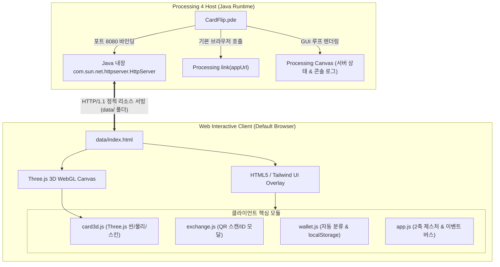
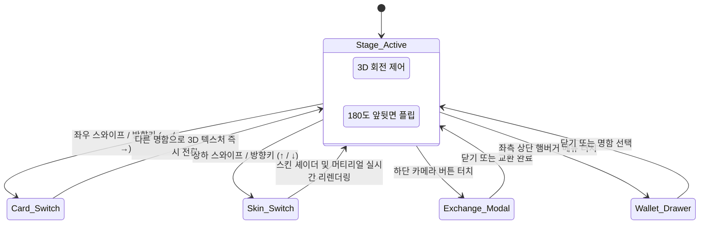

# [TRD] 기술 요구사항 정의서 (Technical Requirements Document)
## 프로젝트명: CardFlip (차세대 인터랙티브 3D 디지털 명함 앱)

---

## 1. 시스템 아키텍처 개요 (System Architecture)

CardFlip은 **Processing 4 (Java 런타임)**를 호스트 실행기로 사용하고, 웹 표준 기술(**Three.js + Vanilla JS + Tailwind CSS**)로 3D 인터랙티브 클라이언트를 구성하는 **무설치 하이브리드 로컬 아키텍처**입니다.



---

## 2. 세부 기술 스택 (Technology Stack Specification)

| 계층 | 사용 기술 | 버전/규격 | 역할 및 선정 사유 |
| :--- | :--- | :--- | :--- |
| **호스트 런타임** | **Processing 4** | 4.3 이상 (Java 17/21) | 과제 제출 필수 실행 도구. ▶ 버튼 하나로 전체 프로세스 론칭 |
| **호스트 서버** | `com.sun.net.httpserver` | JDK 내장 표준 | 외부 `.jar` 설치 없이 정적 웹 리소스(HTML/JS/CSS/이미지)를 로컬 호스팅 |
| **브라우저 자동 론칭** | Processing `link()` | Processing Core API | 데스크톱 기본 브라우저(Chrome/Edge/Safari)를 백그라운드 서버 포트로 자동 실행 |
| **3D 그래픽 엔진** | **Three.js** | r128 (로컬 번들) | 3D 카드 지오메트리, PBR 재질(금속/유리/홀로그램), 조명 및 60fps 렌더링 |
| **UI 프레임워크** | **HTML5 + Tailwind CSS** | Standalone Script | 빌드 도구 없이 모바일 뷰포트 레이아웃, 글래스모피즘 바텀시트, 드로어 구현 |
| **아이콘 팩** | **Lucide Icons** | SVG Standalone | 세련된 미니멀 벡터 아이콘 (카메라, 햄버거, 링크, 닫기 등) |
| **QR 코드 엔진** | **QRCode.js** + Canvas Video | 로컬 스크립트 | 클라이언트 내 명함 QR 코드 생성 및 웹캠 비디오 스트림 디코딩 |
| **데이터 스토리지** | **Browser `localStorage`** | HTML5 Web Storage API | DB 서버 없이 명함 데이터, 스킨 수집 현황, 교환 명함첩 영구 보관 |

---

## 3. Processing 4 호스트 구현 명세 (`CardFlip.pde`)

### 3.1 생명주기 및 실행 흐름
1. **`setup()`**:
   - 윈도우 크기 설정: `size(480, 300);`
   - 포트 점유 검사: 기본 `8080` 포트로 `HttpServer` 인스턴스 생성. 점유 중인 경우 `8081`, `8082`로 자동 증분(Auto-increment)하여 충돌 방지.
   - 정적 파일 핸들러 등록: `sketchPath("data")` 디렉토리를 루트로 매핑하여 MIME 타입에 맞게 파일 스트림 전송.
   - 브라우저 실행: `link("http://localhost:" + PORT + "/");` 호출.
2. **`draw()`**:
   - 다크 테마 대시보드 렌더링 (배경색 `#12121A`).
   - 서버 상태 표시 (RUNNING 상태 초록색 펄스 인디케이터).
   - 접속 URL 안내 (`http://localhost:8080/`).
   - 실시간 클라이언트 HTTP 요청 로그 최근 5건 출력.
   - `[브라우저 다시 열기 (Reopen Browser)]` 클릭 가능한 버튼 렌더링.
3. **`mousePressed()`**:
   - Processing 창 내 '브라우저 다시 열기' 버튼 클릭 좌표 감지 시 `link(appUrl);` 재실행.
4. **`stop()` (종료 훅)**:
   - Processing 스케치 종료 시 `server.stop(0);` 호출로 안전하게 소켓 반환.

### 3.2 정적 리소스 MIME 타입 매핑 테이블
```java
// Java HttpServer 핸들러 내 Content-Type 매핑
switch (ext) {
  case "html": contentType = "text/html; charset=UTF-8"; break;
  case "js":   contentType = "application/javascript; charset=UTF-8"; break;
  case "css":  contentType = "text/css; charset=UTF-8"; break;
  case "json": contentType = "application/json; charset=UTF-8"; break;
  case "png":  contentType = "image/png"; break;
  case "jpg":  
  case "jpeg": contentType = "image/jpeg"; break;
  case "svg":  contentType = "image/svg+xml"; break;
  default:     contentType = "application/octet-stream"; break;
}
```

### 3.3 로컬 네트워크 IP 감지 및 스마트폰 접속 QR 렌더링
- `InetAddress.getLocalHost().getHostAddress()`를 통해 컴퓨터의 로컬 Wi-Fi IP를 자동 추출.
- 스마트폰 동일 Wi-Fi 접속용 URL(`http://<PC-IP>:8080/`)을 생성하고, Processing 창 우측에 접속용 안내 QR 코드를 실시간 드로잉하여 모바일 시연 준비를 0초 만에 완료할 수 있도록 지원.

---

## 4. 3D 인터랙션 및 그래픽 파이프라인 (`card3d.js`)

### 4.1 3D 씬 구조
- **Camera**: `PerspectiveCamera` (FOV: 45°, Aspect Ratio: 모바일 프레임 비율, Near: 0.1, Far: 1000, Position: `[0, 0, 7.5]`)
- **Lighting**:
  - `AmbientLight` (밝기: 0.6, 은은한 전체 조명)
  - `DirectionalLight` (밝기: 0.8, Position: `[5, 5, 5]`, 메탈릭 하이라이트 생성)
  - `PointLight` (Position: `[-5, -5, 3]`, 부드러운 림 라이트)
- **Card Mesh**:
  - 지오메트리: 가로 3.375 x 세로 2.125 x 두께 0.04 (국제 표준 신용카드/명함 비율 85.6mm : 53.98mm)
  - 모서리 라운딩 처리를 적용한 커스텀 둥근 사각 지오메트리 또는 멀티 머티리얼 박스

### 4.2 앞/뒷면 멀티 머티리얼 구조
카드는 6개의 면 중 **앞면(Front), 뒷면(Back), 테두리(Edges)**로 분리된 머티리얼 인덱스를 사용합니다.
- **CanvasTexture 동적 렌더링**:
  - 이름, 소속, 직무, 연락처, QR 등의 텍스트와 UI는 HTML5 가상 Canvas(1024x640px)에 2D 고해상도로 드로잉된 후 `THREE.CanvasTexture`로 변환되어 카드 메시에 실시간 매핑됩니다.
  - 이를 통해 폰트 선명도를 극대화하고 반응형 데이터 업데이트를 즉시 텍스처에 반영합니다.

### 4.3 5종 시그니처 스킨 셰이더/머티리얼 파라미터

| 스킨명 | 베이스 머티리얼 | 파라미터 구성 | 시각적 특징 |
| :--- | :--- | :--- | :--- |
| **Holographic Prism** | `MeshPhysicalMaterial` | `roughness: 0.1`, `metalness: 0.9`, `clearcoat: 1.0`, `iridescence: 1.0` | 빛의 입사각에 따라 무지개빛 오로라가 홀로그램처럼 일렁임 |
| **Matte Dark Obsidian** | `MeshStandardMaterial` | `color: 0x1A1A24`, `roughness: 0.85`, `metalness: 0.2` | 빛을 흡수하는 고급스러운 무광 흑요석 및 은은한 하이라이트 |
| **Glassmorphism Frost** | `MeshPhysicalMaterial` | `transmission: 0.9`, `opacity: 1`, `transparent: true`, `roughness: 0.25`, `ior: 1.5` | 반투명 젖은 유리 느낌으로 배경이 은은하게 투과 |
| **Cyberpunk Neon** | `MeshStandardMaterial` | `color: 0x0A0A12`, `emissive: 0x00FFCC`, `emissiveIntensity: 0.4` | 사이버틱한 네온 라인과 미래지향적 그리드 글로우 |
| **Champagne Gold** | `MeshStandardMaterial` | `color: 0xD4AF37`, `roughness: 0.3`, `metalness: 0.85` | 세련된 헤어라인 브러시드 골드 메탈릭 질감 |

### 4.4 제스처 물리 엔진 (Physics & Motion Math)
1. **드래그 회전 (3D Rotation)**:
   $$\Delta \theta_x = (x_{current} - x_{prev}) \times sensitivity$$
   $$\Delta \theta_y = (y_{current} - y_{prev}) \times sensitivity$$
   - 마우스 이동 델타값을 카드 오브젝트의 `rotation.y`와 `rotation.x`에 가산.
   - 드래그 종료 시 감쇠 계수($\text{damping} = 0.92$)를 적용하여 자연스러운 관성 스핀 연출.
2. **180° 플립 애니메이션 (Front ↔ Back Flip)**:
   - 더블클릭 또는 플립 버튼 트리거 시 Y축 타깃 각도를 $\pi$ (180도) 단위로 회전.
   - 이징 함수(Cubic Ease-Out)를 통해 0.4초간 쫀득하고 탄력 있는 뒤집기 애니메이션 수행.

3. **모바일 터치 & 자이로스코프 센서 (Touch & DeviceOrientation)**:
   - 터치 이벤트(`touchstart`, `touchmove`, `touchend`)를 드래그 델타값으로 1:1 바인딩.
   - 스마트폰 자이로스코프(`window.addEventListener('deviceorientation')`)의 `gamma`(좌우 롤)와 `beta`(상하 피치) 각도를 정규화하여 카드의 기본 휴식 각도에 미세 오프셋으로 반영(Phone Tilt Reaction).

---

## 5. 2축 제스처 및 컨트롤러 아키텍처 (`app.js`)



---

## 6. 데이터 모델 및 스키마 명세 (`wallet.js`)

### 6.1 `localStorage` 키 구조
- `cardflip_my_cards`: 사용자가 생성한 명함 객체 배열 (`Card[]`)
- `cardflip_active_card_idx`: 현재 메인 스테이지에 선택된 명함 인덱스 (`number`)
- `cardflip_exchanged_cards`: 상대방과 교환하여 명함첩에 저장된 명함 객체 배열 (`ExchangedCard[]`)

### 6.2 데이터 스키마 (TypeScript 표기)
```typescript
// 명함 엔티티 스키마
interface BusinessCard {
  id: string;               // 고유 식별자 (예: "card_minsu_01")
  uniqueCode: string;       // 교환용 고유 ID (예: "@minsu_dev")
  isPrimary: boolean;       // 대표 명함 여부
  skinId: string;           // 적용된 스킨 ("hologram" | "matte" | "glass" | "neon" | "gold")
  
  // 앞면 정보
  name: string;             // 이름
  affiliation: string;      // 소속 (회사/대학교)
  occupation: string;       // 직무/직업 (디자이너, 개발자, 기획 등)
  email: string;            // 이메일
  phone: string;            // 연락처
  avatarUrl?: string;       // 프로필 이미지 URL
  
  // 뒷면 정보
  bio: string;              // 한 줄 소개 / 비전
  links: Array<{            // 스마트 링크 목록
    platform: string;       // "github" | "notion" | "linkedin" | "instagram" | "portfolio"
    label: string;          // 버튼에 표시될 텍스트
    url: string;            // 실제 이동할 URL
  }>;
}

// 교환된 명함 엔티티 스키마
interface ExchangedCard extends BusinessCard {
  exchangedAt: string;      // 교환 일시 (ISO String)
  memo?: string;            // 상대방에 대한 개인 메모
  isStarred: boolean;       // 즐겨찾기 등록 여부
}
```

### 6.3 소속 및 직무 자동 분류 알고리즘
- **소속별 분류 (`groupByAffiliation`)**:
  - `card.affiliation` 문자열의 공백 제거 및 소문자 정규화 처리.
  - 동일 소속별로 카운팅 및 아코디언 그룹 트리 생성.
- **직무별 분류 (`groupByOccupation`)**:
  - `card.occupation` 내의 키워드를 분석하여 5대 표준 카테고리(`[디자인]`, `[개발/엔지니어링]`, `[기획/PM]`, `[마케팅/크리에이티브]`, `[기타]`)로 자동 매핑.

---

## 7. 예외 처리 및 오프라인/시연 안정성 설계

1. **포트 충돌 방지**:
   - 8080 포트가 타 프로그램에 의해 점유되어 있을 경우, `try-catch` 블록을 통해 8081, 8082로 순차 시도하여 실패 없는 바인딩 보장.
2. **웹캠 권한 거부 시 Mock QR 스캐너 작동**:
   - 사용자가 브라우저 카메라 권한을 차단하거나 웹캠이 없는 데스크톱 환경에서도 교환 기능을 100% 시연할 수 있도록 **[1초 테스트 QR 자동 인식]** 및 **[사전 등록 ID 간편 선택]** 버튼 제공.
3. **오프라인 완전 구동**:
   - Three.js, Lucide 아이콘 등 모든 자바스크립트 및 스타일 파일을 `data/` 로컬 폴더에 탑재하여 네트워크가 단절된 시험 환경에서도 리소스 로딩 실패 방지.
4. **시연 데이터 원클릭 리셋**:
   - 과제 검사 및 반복 시연을 위해 언제든지 초기 풍성한 샘플 데이터(기본 명함 3장, 교환 명함 8장)로 복원하는 초기화 기능 제공.
