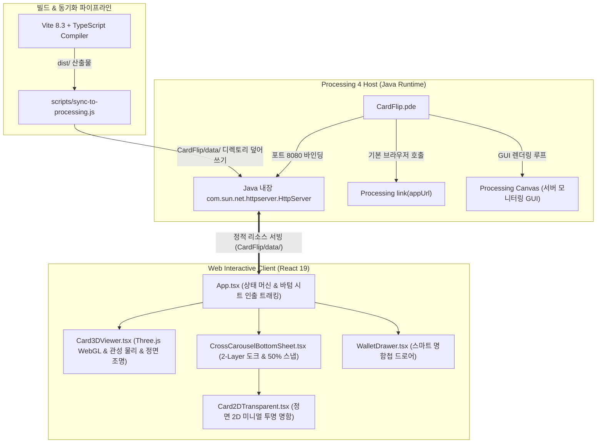

# [TRD] 기술 요구사항 정의서 (Technical Requirements Document)
## 프로젝트명: CardFlip (차세대 인터랙티브 3D 디지털 명함 앱)

> **문서 버전**: v2.0 (최신 구현 반영본)  
> **최종 갱신일**: 2026-11-17  
> **스택**: React 19 + TypeScript + Three.js + Tailwind CSS v4 + Vite + Processing 4 (Java 런처)

---

## 1. 시스템 아키텍처 개요 (System Architecture)

CardFlip은 **Processing 4 (Java 런타임)**를 호스트 실행기로 사용하고, 웹 프론트엔드(**React 19 + TypeScript + Three.js + Tailwind CSS v4**)로 3D 인터랙티브 클라이언트를 구성하는 **하이브리드 로컬 아키텍처**입니다.



---

## 2. 세부 기술 스택 (Technology Stack Specification)

| 계층 | 사용 기술 | 버전/규격 | 역할 및 선정 사유 |
| :--- | :--- | :--- | :--- |
| **호스트 런타임** | **Processing 4** | 4.3 이상 (Java 17/21) | 과제 제출 필수 실행 도구. ▶ 버튼 하나로 전체 프로세스 론칭 |
| **호스트 서버** | `com.sun.net.httpserver` | JDK 내장 표준 | 외부 `.jar` 설치 없이 정적 웹 리소스(HTML/JS/CSS/이미지)를 로컬 호스팅 |
| **UI 프레임워크** | **React 19** + **TypeScript** | 19.3 / 7.0 | 컴포넌트 기반 선언적 상태 관리, 2축 제스처 오프셋 관리 |
| **3D 그래픽 엔진** | **Three.js** | 0.187 | 3D 물리 관성 회전, 단일 탭 수직 정렬, 정면 최적화 듀얼 키라이트 시스템 |
| **스타일링** | **Tailwind CSS v4** | 4.3.5 | 유틸리티 퍼스트 CSS, 글래스모피즘, 실시간 트랜스폼 및 50% 스냅 애니메이션 |
| **빌드 도구** | **Vite** | 8.3.8 | 초고속 HMR 개발 서버, `server: { host: true }`를 통한 Wi-Fi 모바일 접속 |
| **동기화 자동화** | Node.js 스크립트 | `sync-to-processing.js` | `npm run build:sync` 시 `web/dist`를 `CardFlip/data`로 원클릭 복사 |

---

## 3. 핵심 알고리즘 및 물리 구현 명세

### 3.1 3D 카드 관성 회전(Inertia) & 단일 탭 정렬 (`Card3DViewer.tsx`)
```typescript
// 1. 관성 속도 추적 (Pointer Move)
const instantVx = (dy / dt) * 0.045;
const instantVy = (dx / dt) * 0.045;
velocity.current.x = velocity.current.x * 0.35 + instantVx * 0.65;
velocity.current.y = velocity.current.y * 0.35 + instantVy * 0.65;

// 2. 관성 회전 및 감속 (Animation Loop)
if (Math.abs(velocity.current.x) > 0.0001 || Math.abs(velocity.current.y) > 0.0001) {
  currentRotation.current.x += velocity.current.x;
  currentRotation.current.y += velocity.current.y;
  currentRotation.current.x = Math.max(-0.95, Math.min(0.95, currentRotation.current.x));
  velocity.current.x *= 0.94; // 0.94 감속비 적용
  velocity.current.y *= 0.94;
}

// 3. 단일 탭 앞/뒷면 똑바로 정렬 (Single Tap Align)
const cosY = Math.cos(currentRotation.current.y);
targetRotation.current.x = 0; // X축 틸트 완전 초기화
if (cosY >= 0) {
  // 앞면 -> 가장 가까운 뒷면 ((2k+1)*PI)로 정렬
  const k = Math.round((curY - Math.PI) / (2 * Math.PI));
  targetRotation.current.y = (2 * k + 1) * Math.PI;
} else {
  // 뒷면 -> 가장 가까운 앞면 (2k*PI)로 정렬
  const k = Math.round(curY / (2 * Math.PI));
  targetRotation.current.y = 2 * k * Math.PI;
}
```

### 3.2 정면 최적화 3D 조명 시스템
- **전방향 환경광**: `THREE.AmbientLight(0xffffff, 0.95)` (기본 전방향 밝기 확보)
- **듀얼 정면 키라이트**:
  - `frontLightLeft`: `(-1.8, 2.2, 5.5)`, intensity `0.95`
  - `frontLightRight`: `(1.8, 2.2, 5.5)`, intensity `0.95`
  - 카메라 렌즈 직사각을 살짝 비켜난 전방 상단에서 명함 앞면을 직접 비추어, 눈부신 글레어(Hotspot) 없이 선명한 가독성 확보.
- **톤매핑 노출**: `renderer.toneMappingExposure = 1.12`.

### 3.3 2-Layer 물리 메커니즘 (`CrossCarouselBottomSheet.tsx`)
- **Layer 1 (뒷단)**: `left: 50%, transform: translate(-50%, skinDragY)` 위치에 고정된 300×190px 활성 스킨 플레이트.
- **Layer 2 (앞단)**: `left: 50%, transform: translateX(calc(-150px - carouselIdx * 316px + cardDragX))` 위치의 수평 명함 트랙.
- 카드가 바뀌어도 `activeSkinId` 상태가 유지되어 새로 슬라이드 인된 카드에 동일 스킨이 투영됨.

### 3.4 50% 임계값(Threshold) 스냅 시스템
- **명함 수평 캐러셀**: `CARD_SNAP_THRESHOLD = 158px`
  - `cardDragX < -158px` → `carouselIdx + 1` (다음 명함)
  - `cardDragX > 158px` → `carouselIdx - 1` (이전 명함)
  - 미만 시 원래 위치로 스냅 백
- **스킨 수직 캐러셀**: `SKIN_SNAP_THRESHOLD = 50px`
  - `skinDragY > 50px` → 이전 스킨 장착
  - `skinDragY < -50px` → 다음 스킨 장착
  - 미만 시 원래 스킨으로 스냅 백
- **바텀 시트 열기/닫기**: `THRESHOLD = 120px` 기준 스냅 오픈 / 스냅 닫기 / 스냅 백.

---

## 4. 빌드 및 동기화 명령어

```bash
# 1. 패키지 설치
cd web
npm install

# 2. 로컬 개발 서버 실행 (Wi-Fi 스마트폰 접속 허용)
npm run dev

# 3. Processing 4 하이브리드 빌드 및 동기화
npm run build:sync
```
