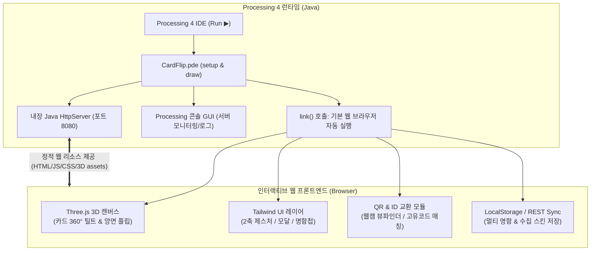

# [기획서] 차세대 인터랙티브 3D 디지털 명함 앱 : CardFlip (Processing 4 연동형)

---

## 1. 프로젝트 개요

### 1.1 기획 배경 및 필요성
- **종이 명함의 한계**: 인쇄 비용 발생, 정보 변경 시 재인쇄 필요, 분실 위험, 하이퍼링크/포트폴리오 직접 연결 불가.
- **멀티 페르소나 시대**: 본업(직장인/학생), 부업(크리에이터/프리랜서), 개인 네트워킹 등 한 사람이 여러 개의 정체성을 가지고 활동하는 트렌드 확산.
- **인터랙티브 3D 경험 요구**: 단순한 평면 2D 텍스트 나열을 넘어, 3차원 공간에서 카드를 자유자재로 만지고 틸팅하며 스킨 텍스처를 변경하는 촉각적·시각적 몰입감 제공.

### 1.2 핵심 실행 제약 및 목표 (Key Constraint & Goal)
- **최종 실행 도구**: **Processing 4**
  - 평가자(교수/조교)가 Processing 4 IDE에서 스케치를 열고 **Run(▶) 버튼을 누르면 즉시 구동**되어야 함.
  - 외부 Java 라이브러리 추가 설치 없이 순수 Java 내장 경량 서버로 정적 리소스 호스팅 및 브라우저 자동 론칭(`link()`).
- **프론트엔드 인터랙션 스택**: **Three.js + HTML5 / Tailwind CSS + Web API**
  - WebGL 기반 3D 카드 물리 회전 및 양면 플립 렌더링.
  - 모바일 터치 및 마우스 제스처 기반 2축 스와이프 인터페이스.
  - 카메라 API를 활용한 실시간 QR 스캔 및 고유 ID 교환 모듈.

---

## 2. 시스템 아키텍처 (Processing 4 + Web Hybrid)



---

## 3. 화면 레이아웃 및 제스처 인터랙션 설계

### 3.1 [홈 화면] 메인 스테이지 및 제스처 구조
홈 화면은 불필요한 내비게이션 바를 최소화하고, 화면 중앙의 3D 명함에 몰입할 수 있도록 설계합니다.

```
+-------------------------------------------------------+
|  [☰ 햄버거 메뉴]                     [🔔 알림] [⚙ 설정] |
|                                                       |
|                     ▲ [스킨 위로 스와이프]             |
|                                                       |
|   ◀ [이전 명함]     +--------------------+   ▶ [다음 명함 / +]
|  (또는 방향키 ←)    |                    |   (또는 방향키 →)   |
|                    |    3D 명함 앞면    |             |
|                    |   (드래그 시 3D 회전|             |
|                    |    클릭 시 180°플립)|             |
|                    |                    |             |
|                    +--------------------+             |
|                                                       |
|                     ▼ [스킨 아래로 스와이프]           |
|                                                       |
|             +-------------------------------+         |
|             |  [ 📷 QR 스캐너 / ID 입력 ]   |         |
|             +-------------------------------+         |
+-------------------------------------------------------+
```

#### 제스처 및 컨트롤 명세
| 동작 (Gesture / Key) | 대상 | 동작 설명 및 피드백 |
| :--- | :--- | :--- |
| **좌 / 우 스와이프 / 방향키 (← / →)** | 메인 스테이지 | - 내가 보유한 여러 개의 명함 순차 전환<br>- 가장 마지막 슬라이드에 **[+ 새 명함 만들기]** 카드 노출<br>- 하단 인디케이터(Dots)로 현재 카드 위치 표시 |
| **상 / 하 스와이프 / 방향키 (↑ / ↓)** | 현재 활성화된 명함 | - 보유 중인 **스킨 콜렉션**을 롤러블 형태로 실시간 변경 적용<br>- 스킨 전환 시 카드 표면 반사광/글로우 애니메이션 연출 |
| **마우스/터치 드래그** | 3D 명함 영역 | - 마우스 또는 터치 궤적에 따라 3차원 공간에서 카드가 360° 자유 회전 |
| **더블 클릭 또는 플립 버튼** | 3D 명함 영역 | - Y축 기준 180° 스무스 회전하여 **앞면(주요 프로필) ↔ 뒷면(링크/바이오)** 전환 |
| **링크 칩 클릭** | 카드 내 URL 버튼 | - Notion, GitHub, LinkedIn, 웹사이트 등 해당 URL을 새 탭으로 접속 |

---

### 3.2 [하단 액션] QR 코드 촬영 및 고유 ID 교환 모달

홈 화면 하단의 카메라 버튼 터치 시 오픈되는 바텀 시트입니다.

```
+-------------------------------------------------------+
|                       [ 드래그 핸들 ]                  |
|                   명함 교환하기                       |
|   +-----------------------------------------------+   |
|   |                  [카메라 뷰파인더]             |   |
|   |         상대방의 QR코드를 비춰주세요          |   |
|   |         (웹캠 없는 경우 테스트 QR 샘플 제공)  |   |
|   +-----------------------------------------------+   |
|                                                       |
|   --- 또는 고유 ID로 찾기 -------------------------   |
|   +----------------------------------+ +----------+   |
|   | @ 고유 ID 입력 (예: designer_kim) | | 교환 요청|   |
|   +----------------------------------+ +----------+   |
|                                                       |
|   [내 대표 명함 QR 보기]    [내 고유 ID 복사: #CARD-77] |
+-------------------------------------------------------+
```

---

### 3.3 [좌측 메뉴] 교환된 명함 콜렉션 (지능형 명함첩)

홈 화면 좌측 상단의 햄버거(☰) 메뉴를 터치하면 교환된 명함 아카이브 창으로 진입합니다.

```
+-------------------------------------------------------+
|  [← 뒤로가기]       교환한 명함첩 (총 18장)       [🔍 검색]|
+-------------------------------------------------------+
|  [전체]   [🏢 소속별 분류 ▼]   [💼 직업별 분류 ▼]   [⭐ 즐겨찾기]|
+-------------------------------------------------------+
|  ▼ 소속: 한국대학교 디자인학부 (4)                    |
|    +--------------------+  +--------------------+     |
|    | [미니 3D 카드]     |  | [미니 3D 카드]     |     |
|    | 이서연 (인터랙션)  |  | 정다은 (모션그래픽)|     |
|    +--------------------+  +--------------------+     |
|  ▼ 소속: 네오스튜디오 (6)                             |
|    +--------------------+  +--------------------+     |
|    | [미니 3D 카드]     |  | [미니 3D 카드]     |     |
|    | 박현우 (개발 리드) |  | 최유진 (프로덕트)  |     |
|    +--------------------+  +--------------------+     |
+-------------------------------------------------------+
```

---

## 4. 5대 핵심 기능 명세

1. **멀티 디지털 명함 생성 & 스킨 커스텀**
   - 1인 다명함 지원: 학생용, 작가/디자이너용, 공식 포트폴리오용 명함 생성 및 전환.
   - 5종 시그니처 3D 스킨:
     1. `Holographic Prism`: 빛에 따라 무지개색 그라디언트가 일렁이는 셰이더.
     2. `Matte Dark Obsidian`: 매트한 무광 블랙 질감에 은은한 림 라이트.
     3. `Glassmorphism Frost`: 반투명 굴절 아크릴 느낌의 트렌디한 질감.
     4. `Cyberpunk Neon`: 어두운 배경에 네온 라인 및 미래지향적 타이포.
     5. `Pure Minimal White`: 정갈한 모던 비즈니스 스타일.
2. **양방향 QR & 고유 ID 교환**
   - 실시간 내 명함 전용 QR 렌더링.
   - 웹 브라우저 카메라 권한을 이용한 QR 디코딩 (HTML5 Video Stream).
   - 상대방 고유 식별 코드(ID) 검색을 통한 즉시 명함 데이터 추가.
3. **클릭 가능한 인터랙티브 하이퍼링크**
   - 앞/뒷면에 배치된 링크 칩(GitHub, Portfolio, LinkedIn, Instagram, Blog 등).
   - 클릭 시 즉각적인 외부 브라우징 지원.
4. **소속/직무 기반 지능형 자동 분류**
   - 교환된 명함 데이터의 `소속(Affiliation)` 및 `직업(Occupation/Role)` 키워드 자동 인덱싱.
   - 탭 선택을 통해 '소속별 그룹화' 또는 '직군별 그룹화' 뷰로 즉시 정렬.
5. **3D 자유 회전 및 앞/뒷면 정보 기록**
   - Three.js WebGL 씬 내에서 부드러운 드래그 회전 물리(Inertia & Damping).
   - 180° Y축 회전으로 앞면(아이덴티티)과 뒷면(상세 링크/메모)의 명확한 정보 분리.

---

## 5. 프로젝트 디렉토리 구조 (Processing 4 호환)

Processing 4는 **메인 폴더명과 `.pde` 파일명이 반드시 동일**해야 합니다.

```text
기말고사 프로젝트_NEW/
├── CardFlip/                        <-- Processing 4 프로젝트 루트 폴더
│   ├── CardFlip.pde                 <-- Processing 메인 스케치 (Java 내장 서버 구동 + UI 모니터)
│   └── data/                        <-- Processing 정적 에셋 및 웹 빌드 폴더
│       ├── index.html               <-- 웹 인터랙티브 앱 메인 뷰어
│       ├── css/
│       │   └── style.css            <-- Tailwind CSS 및 커스텀 스타일
│       ├── js/
│       │   ├── app.js               <-- 앱 메인 로직 & 상태 관리
│       │   ├── card3d.js            <-- Three.js 3D 카드 렌더링 & 제스처 엔진
│       │   ├── exchange.js          <-- QR 스캔 / 생성 / ID 교환 모듈
│       │   └── wallet.js            <-- 자동 분류 명함첩 모듈
│       └── assets/
│           ├── textures/            <-- 스킨용 텍스처 / 노멀맵
│           └── icons/               <-- UI 아이콘
└── 기획서_디지털_명함_앱.md           <-- 본 기획서 문서
```

---

## 6. Processing 4 실행 메커니즘 (Java Implementation)

Processing 4 스케치(`CardFlip.pde`) 내부 구현 구조:

```java
// CardFlip.pde 핵심 로직 개요
import com.sun.net.httpserver.*;
import java.net.*;
import java.io.*;

HttpServer server;
int PORT = 8080;
String appUrl = "http://localhost:8080/";

void setup() {
  size(450, 260);
  surface.setTitle("CardFlip Host Server - Processing 4");
  
  // 1. 내장 Java HTTP 서버 실행 (data/ 폴더 정적 파일 매핑)
  startWebServer();
  
  // 2. 기본 브라우저로 3D 인터랙티브 웹 앱 자동 실행
  link(appUrl);
}

void draw() {
  background(24, 24, 32);
  // 서버 상태, 활성 포트, 안내 문구 및 '브라우저 다시 열기' 버튼 렌더링
  drawServerDashboard();
}

void mousePressed() {
  // Processing 창에서 '브라우저 다시 열기' 버튼 클릭 시 link(appUrl) 재실행
}
```

---

## 7. 단계별 제작 로드맵 (Milestones)

1. **1단계: Processing 4 런타임 & 호스트 스케치 구축**
   - `CardFlip.pde` 작성: 내장 `HttpServer` 구동 및 브라우저 자동 호출(`link`) 테스트 완료.
2. **2단계: Three.js 3D 카드 인터랙션 & 2축 제스처 구현**
   - 드래그 3D 회전, 180° 플립, 좌우 스와이프(명함 전환), 상하 스와이프(스킨 교체) 완성.
3. **3단계: 5종 3D 스킨 머티리얼 & 양면 링크 시스템**
   - 홀로그램, 매트 블랙, 글래스모피즘 등 텍스처/셰이더 적용 및 URL 칩 클릭 연동.
4. **4단계: QR 스캐너 / ID 교환 & 소속/직무 자동 분류 명함첩**
   - 웹캠 기반 QR 스캐너 및 ID 입력 창 제작, 소속/직무별 카테고리 뷰 구현.
5. **5단계: 기말 최종 점검 및 Processing 4 패키징**
   - Processing 4에서 재생(▶) 버튼 1회 클릭 시 무결점 구동 확인 및 발표 자료 준비.
