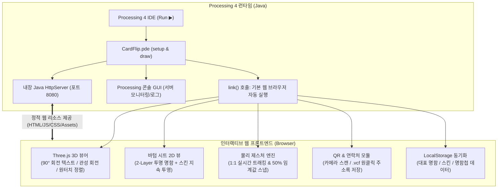

# [기획서] 차세대 인터랙티브 3D 디지털 명함 앱 : CardFlip (Processing 4 연동형)

> **문서 버전**: v2.0 (최신 구현 반영본)  
> **최종 갱신일**: 2026-11-17  
> **핵심 스택**: Processing 4 (Java 런처) + React 19 + TypeScript + Three.js + Tailwind CSS v4  

---

## 1. 프로젝트 개요

### 1.1 기획 배경 및 필요성
- **종이 명함의 한계**: 인쇄 비용 발생, 정보 변경 시 재인쇄 필요, 분실 위험, 하이퍼링크/포트폴리오 직접 연결 불가.
- **멀티 페르소나 시대**: 본업(직장인/학생), 부업(크리에이터/프리랜서), 개인 네트워킹 등 한 사람이 여러 개의 정체성을 가지고 활동하는 트렌드 확산.
- **인터랙티브 3D & 실물 촉각 경험**: 단순한 평면 텍스트를 넘어, 3차원 공간에서 카드를 자유자재로 만지고 틸팅하며 스킨 텍스처를 변경하고, 실시간 손가락 추적 및 50% 임계값 물리 스냅을 제공하는 인터랙티브 경험 제공.

### 1.2 핵심 실행 제약 및 목표 (Key Constraints & Goals)
- **최종 실행 도구**: **Processing 4**
  - 평가자(교수/조교)가 Processing 4 IDE에서 스케치를 열고 **Run(▶) 버튼을 누르면 즉시 구동**.
  - 외부 Java 라이브러리 추가 설치 없이 순수 Java 내장 경량 서버로 정적 리소스 호스팅 및 브라우저 자동 론칭(`link()`).
- **프론트엔드 인터랙션 스택**: **Three.js + React 19 + Tailwind CSS + Web API**
  - WebGL 기반 3D 카드 물리 관성 회전(Inertia) 및 원터치 똑바로 정렬.
  - 바텀 시트 내 2-Layer 물리 메커니즘 (투명 2D 명함 + 배후 컬러 스킨 투영).
  - 스마트폰 카메라를 통한 실시간 QR 교환 및 Wi-Fi 로컬 네트워크 접속 지원.

---

## 2. 시스템 아키텍처 (Processing 4 + Web Hybrid)



---

## 3. 화면 레이아웃 및 제스처 인터랙션 설계

### 3.1 [홈 화면] 세로 뷰포트 & 3D 대표 명함 스테이지
홈 화면은 불필요한 내비게이션을 전면 배제하고, 대표 명함 1장과 핵심 액션에 온전히 집중하도록 설계되었습니다.

```
+-------------------------------------------------------+
|                                                       |
|                                                       |
|                                                       |
|                  +-----------------+                  |
|                  |                 |                  |
|                  |   대표 명함     |                  |
|                  |  (가로 텍스트가 |                  |
|                  |   90° 시계방향  |                  |
|                  |   회전된 3D 카드|                  |
|                  |   관성 회전 &   |                  |
|                  |   원터치 정렬)  |                  |
|                  |                 |                  |
|                  +-----------------+                  |
|                                                       |
|                                                       |
|                      [ QR ]                           |
|                    (하단 정중앙)                      |
|                                                       |
|                  --- 바텀 시트 ---                    |
|                (위로 끌어올려 열기)                   |
+-------------------------------------------------------+
```

#### 홈 화면 세부 명세
1. **대표 명함 1장 단독 고정**:
   - 홈 화면에서는 좌우로 스와이프해도 다른 명함으로 변경되지 않으며, 사용자가 대표로 설정한 명함 단 1장만 표시됩니다.
   - 다른 명함으로 교체하는 작업은 바텀 시트에서만 수행됩니다.
2. **세로 폰 최적화 90° 시계방향 회전 텍스트**:
   - 스마트폰은 항상 세로 방향으로 파지하며, 명함의 텍스트가 시계방향으로 90도 회전되어 세로 화면 안에서 명함이 가장 크고 시원하게 보이도록 배치됩니다.
3. **물리 관성 회전 (Inertia & Deceleration)**:
   - 손가락으로 카드를 틸트/회전시킬 때의 이동 속도를 실시간 계산합니다.
   - 손가락을 떼도 즉시 멈추지 않고, 잔여 회전 속도로 더 돌다가 감속비(`0.94`)를 거쳐 서서히 멈춥니다.
   - 멈췄을 때 정면이 아니어도 멈춘 그 각도 그대로 자연스럽게 정지합니다.
4. **단 한 번의 터치(Single Tap)로 똑바로 정렬**:
   - 명함이 어느 각도로 삐뚤어져 있든 상관없이 가볍게 한 번 터치하면 X축 틸트를 0으로 초기화하고 즉시 수직으로 똑바로 정렬됩니다.
   - 앞면을 보고 있을 때 탭하면 뒷면(180°), 뒷면을 보고 있을 때 탭하면 앞면(0°)으로 전환됩니다.
5. **정면 최적화 조명 시스템**:
   - 전방향 균일 환경광(`1.6`) + 카메라 정면 상단 좌/우 듀얼 키라이트(`0.95`)를 배치하여, 정면을 바라볼 때 어두운 그늘이나 과도한 글레어 없이 선명하고 환한 가독성을 제공합니다.
6. **하단 컨트롤러**:
   - 화면 하단 정중앙에 플로팅 QR 버튼 배치 (터치 시 카메라 스캐너 및 내 QR 모달 오픈).
   - 화면 최하단에 바텀 시트 제스처 핸들 바 배치 (위로 120px 이상 끌어올리면 바텀 시트 스냅 오픈).

---

### 3.2 [바텀 시트 화면] 2축 크로스 캐러셀 & 2-Layer 물리 메커니즘
홈 화면에서 바텀 시트 핸들을 위로 끌어올리거나 터치하면 나타나는 명함 탐색 및 스킨 커스텀 화면입니다.

```
+-------------------------------------------------------+
|                      [ 드래그 핸들 ]               [X]|
|                                                       |
|                  +-----------------+                  |
|                  |  상단 스킨 (이전) |  (순수 컬러 플레이트)
|                  +-----------------+                  |
|                                                       |
| +------+        +-----------------+       +---------+ |
| |+ 새  |        |  2D 투명 명함    |       | 다음    | |
| | 명함 |        | (뒷단 스킨 투영) |       | 명함 2  | |
| |      |        +-----------------+       | (피크)  | |
| +------+        | 중앙 액티브 스킨|       +---------+ |
|                 +-----------------+                   |
|                                                       |
|                  +-----------------+                  |
|                  |  하단 스킨 (다음) |  (순수 컬러 플레이트)
|                  +-----------------+                  |
|                                                       |
|              [ ★ 대표 명함으로 설정 ]                |
|              [      명함첩          ]                 |
+-------------------------------------------------------+
```

#### 바텀 시트 세부 명세
1. **프레임 완전 배제 및 순수 미니멀리즘**:
   - 명함이나 스킨을 감싸는 박스/프레임 UI를 전면 삭제하고 화면 무대에 직접 플롯(Direct Plot)합니다.
   - 모든 가이드 텍스트(`상하 스와이프`, `좌우 스와이프` 등) 및 카드 위의 메타 아이콘(공유, 수정, 대표 배지, 뒤집기)을 일체 삭제했습니다.
2. **2D 정면 투명 명함 (`Card2DTransparent`)**:
   - 바텀 시트 내부에서는 3D 틸트/회전 없이 앞면만 100% 명확히 보이는 2D 뷰로 고정됩니다.
   - 텍스트와 외곽 테두리 외에는 투명 색상이며, 뒤쪽 스킨 색상이 100% 투영되어 비칩니다.
3. **2-Layer 물리 메커니즘 & 스킨 지속성(Persistence)**:
   - **Layer 1 (뒷단)**: 중앙 도킹 위치에 명함과 동일한 크기/형태의 2D 순수 컬러 스킨 플레이트가 위치합니다.
   - **Layer 2 (앞단)**: 투명 명함들이 수평 트랙 위를 슬라이드합니다.
   - 상하로 스와이프하면 스킨이 중앙 도크로 미끄러져 들어와 명함 색상이 실시간으로 교체됩니다.
   - 좌우로 스와이프하여 다른 명함으로 넘겨도, **현재 상하 스와이프된 스킨은 중앙 도크에 그대로 유지**되어 새로 들어온 명함에 연속 투영됩니다.
4. **명함 순서 체계 및 우측 피크(Peek-in)**:
   - 순서: `0 (새 명함 제작)` — `1 (대표 명함)` — `2 (명함 2)` — `3 (명함 3) ...`
   - 명함 목록은 오른쪽으로만 선형 스택되며, 우측 다음 명함의 일부(~40px)가 살짝 노출되어 수평 캐러셀의 존재를 직관적으로 암시합니다.
   - 대표 명함(1번)에서 왼쪽으로 스와이프하면 `0번 [+ 새 명함 제작]` 슬롯이 중앙으로 부드럽게 넘어옵니다.
5. **`[+ 새 명함 제작]` 슬롯 (0번)**:
   - 일반 명함과 동일한 340×200 규격의 2D 투명 카드 형태입니다.
   - 정중앙에 작은 흰색 테두리 사각 박스 + 내부 녹색 플러스(`+`) 아이콘만 배치 (설명 텍스트 없음).
   - 슬롯 테두리 안쪽 어디든 터치하면 명함 제작 모달이 즉시 실행되며, 새로 제작한 명함은 명함 목록 가장 오른쪽 끝(Tail)으로 자동 추가됩니다.
6. **하단 2단 수직 버튼 구성**:
   - **상단: `[★ 대표 명함으로 설정]` 버튼**:
     - 2번 이상의 명함을 보고 있을 때 터치하면 해당 명함이 명함 목록 최좌측(1번 대표 자리)으로 승격되고, 기존 대표 명함은 우측으로 한 칸 밀려납니다.
     - 1번 명함을 보고 있을 때는 `[★ 현재 대표 명함]` 활성 상태로 표시됩니다.
   - **하단: `[명함첩]` 버튼**:
     - 상단 버튼과 완전히 동일한 크기 및 둥근 모서리 형태로 배치되어 교환된 명함 지갑을 엽니다.
   - 바텀 시트 내 QR 버튼은 완전 삭제되었습니다.
7. **1.5초 롱프레스 제스처**:
   - 중앙 명함을 1.5초간 누르고 있으면 카드가 살짝 플로팅(`scale-105`, 엘리베이션 그림자)합니다.
   - **유지한 채 좌우 드래그**: 양옆 이웃 명함들과 실시간 순서 맞바꿈(Swap).
   - **드래그 없이 손을 뗌**: 명함 정보 수정을 위한 편집 모달 즉시 실행.

---

### 3.3 [물리 제스처 시스템] 실시간 1:1 트래킹 & 50% 임계값 스냅

앱 내 모든 스와이프 제스처는 손가락 움직임을 지연 없이 1:1로 실시간 추적하며, 손을 뗐을 때 이동 거리의 50% 임계값(Threshold)을 기준으로 스냅 동작합니다.

| 제스처 대상 | 1:1 실시간 트래킹 | 50% 임계값 판정 및 스냅(Snap) 규칙 |
| :--- | :--- | :--- |
| **명함 수평 캐러셀** | 좌우 드래그 시 명함 트랙 실시간 이동 (경계 저항 적용) | • **임계값:** 카드 폭 50% (`158px`)<br>• 50% 이상 이동 시 다음/이전 명함으로 **스냅 전환**<br>• 50% 미만 이동 시 원래 명함으로 **스냅 백** |
| **스킨 수직 캐러셀** | 상하 드래그 시 상/중/하 스킨 플레이트 실시간 수직 이동 | • **임계값:** 스킨 간격 50% (`50px`)<br>• 50% 이상 이동 시 이전/다음 스킨으로 **스냅 장착**<br>• 50% 미만 이동 시 원래 스킨으로 **스냅 백** |
| **바텀 시트 열기** | 홈 화면 핸들을 잡고 위로 끌어올리면 시트가 실시간 상승 | • **임계값:** 인출 거리 50% (`120px`)<br>• 50% 이상 상승 시 전체 화면으로 **스냅 오픈**<br>• 50% 미만 상승 시 홈으로 **스냅 백** |
| **바텀 시트 닫기** | 시트 상단 핸들을 잡고 아래로 내리면 시트가 실시간 하강 | • **임계값:** 화면 높이 50% (`120px`)<br>• 50% 이상 하강 시 홈 화면으로 **스냅 닫기**<br>• 50% 미만 하강 시 완전 오픈으로 **스냅 백** |
| **명함첩 서랍 닫기** | 서랍을 잡고 왼쪽으로 밀면 서랍이 실시간 좌측 이동 | • **임계값:** 서랍 폭 50% (`140px`)<br>• 50% 이상 밀면 서랍 **스냅 닫기**<br>• 50% 미만이면 완전 오픈으로 **스냅 백** |

---

## 4. 데이터 모델 및 스토리지 구조

### 4.1 명함 데이터 구조 (`CardData`)
```typescript
export interface CardData {
  id: string;              // 고유 ID (예: 'my_card_01')
  uniqueCode: string;      // 유니크 핸들 (예: '@minsu_design')
  isPrimary?: boolean;     // 대표 명함 여부 (배열 0번째가 항상 대표)
  skinId: SkinId;          // 장착된 스킨 ID ('hologram' | 'matte' | 'glass' | 'neon' | 'gold')
  name: string;            // 사용자 이름
  affiliation: string;     // 소속 조직 / 학교 / 회사
  occupation: string;      // 직무 / 학과 / 타이틀
  email: string;           // 이메일
  phone: string;           // 전화번호
  bio: string;             // 자기소개 한 줄 바이오
  avatarUrl?: string;      // 프로필 이미지 URL
  links: LinkItem[];       // 하이퍼링크 목록 (포트폴리오, GitHub, Notion 등)
  createdAt?: string;
  updatedAt?: string;
}
```

### 4.2 스토리지 동기화 키 (`LocalStorage`)
* `cardflip_my_cards_v2`: 내 보유 명함 목록 (0번 인덱스가 항상 대표 명함)
* `cardflip_active_idx_v2`: 현재 선택된 활성 명함 인덱스
* `cardflip_exchanged_cards_v2`: 교환하여 명함첩에 보관된 상대방 명함 목록

### 4.3 Device UUID 기반 다중 기기 독립 격리 및 영구 보존 아키텍처
* **로그인 없는 무중단 다중 기기 지원**: 복잡한 회원가입/로그인 절차 없이, 각 기기(PC, 스마트폰 A, 스마트폰 B 등)가 접속할 때마다 고유한 **Device UUID**(`cardflip_device_id_v2`)를 자동 부여받아 독립 사물함 운용.
* **스마트폰 다자간 접속 완벽 지원**:
  - 스마트폰 1대, 2대, 10대가 동시에 동일한 Wi-Fi 서버에 접속하더라도, 각 기기마다 별도의 사물함(`devices[devId]`)에 본인의 명함과 명함첩을 저장하므로 데이터 충돌이나 덮어쓰기가 전혀 발생하지 않음.
* **제작 명함 vs 수집 명함 엄격 분리**:
  - **내 명함 목록 (`myCards`)**: 해당 기기 사용자가 직접 제작/수정한 명함 (PC: 곽두팔, 스마트폰 A: 박상).
  - **받은 명함첩 (`exchangedCards`)**: QR 코드 스캔 또는 고유 ID 조회를 통해서만 추가되는 상대방 명함.
* **실시간 디스크 동기화 (`POST /api/sync?dev=deviceId`)**: 명함 변경 시 250ms 디바운스를 거쳐 서버 파일(`app_state.json`)의 본인 기기 사물함에 자동 영구 기록.
* **앱 부팅 시 자동 복원 (`GET /api/sync?dev=deviceId`)**: 서버 재구동, 포트 변경, 브라우저 재시작 시에도 본인의 기기 ID로 서버에서 자기 사물함 데이터만 정확히 복원(Hydration).

---

## 5. 실행 및 테스트 환경

1. **Processing 4 실행**:
   - `CardFlip/CardFlip.pde` 오픈 후 재생(▶) 클릭 → 내장 웹서버를 통해 브라우저 자동 실행.
2. **모바일 Wi-Fi 접속**:
   - 동일한 로컬 Wi-Fi 환경에서 스마트폰 카메라로 `phone_connect_qr.png` 스캔 또는 `http://192.168.0.31:5173` 접속.
3. **빌드 동기화**:
   - `npm run build:sync`: 변경된 웹 빌드를 `CardFlip/data/` 디렉토리에 자동 배포.
